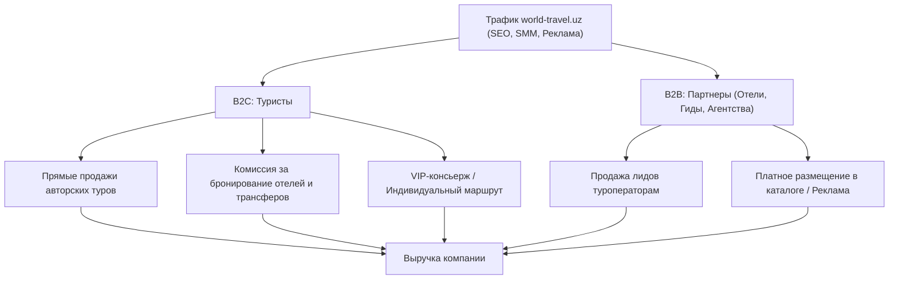

# Монетизация world-travel.uz

Базовая схема потоков монетизации и конверсии трафика.

## Как редактировать схему

1. **Блоки (узлы):** `ID["Текст внутри блока"]` — уникальный ID латиницей и в кавычках текст.
2. **Связи (стрелки):** 
   - `A --> B` (простая стрелка от A к B)
   - `A -->|Подпись над стрелкой| B`
3. **Направление:** В первой строке `flowchart TD` (сверху вниз) можно заменить на `flowchart LR` (слева направо).
