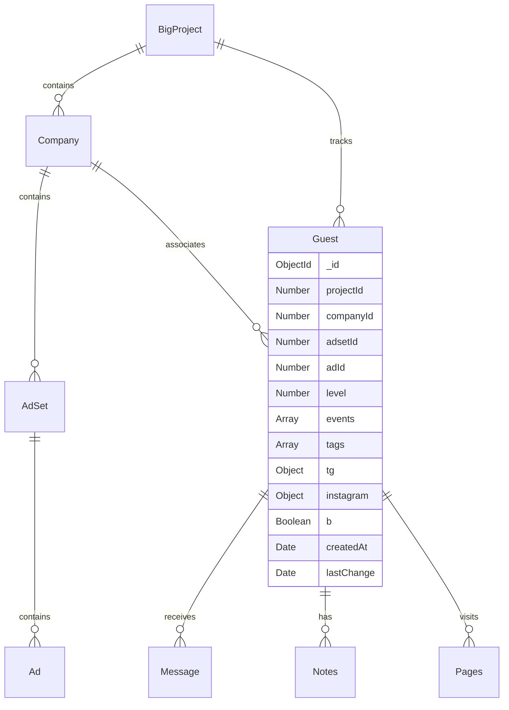

# Глоссарий проекта Ishvara

Ishvara — маркетинговая CRM-система, трекер сквозной аналитики и коммуникационная платформа (Telegram-боты, веб-трекинг, интеграция с Meta Conversions API / Facebook CAPI).

---

## 1. Ключевые термины предметной области

| Термин | Описание | Основные сущности / поля |
| :--- | :--- | :--- |
| **Гость (Guest)** | Посетитель лендингов или пользователь Telegram-ботов. Хранит сессию, историю действий, UTM/параметры переходов, присвоенные теги и уровень воронки. | Модель [Guest.ts](file:///d:/_sites/ishvara/server/src/models/Guest.ts), интерфейс [IGuest.ts](file:///d:/_sites/ishvara/shared/types/IGuest.ts) |
| **Большой проект (BigProject)** | Верхнеуровневый проект/бизнес-направление (например: «World Travel» ID 5, «Медитация» ID 10, «vmeste.uz» ID 15, «Esho.uz» ID 100). | [projects_config.ts](file:///d:/_sites/ishvara/shared/projects_config.ts) (`IBigProjectConfig`) |
| **Кампания (Company)** | Рекламная кампания или воронка внутри проекта (например, вебинар, мастермайнд, запуск от даты). | `ICompany` в [projects_config.ts](file:///d:/_sites/ishvara/shared/projects_config.ts), `guest.companyId` |
| **Группа объявлений (AdSet)** | Подгруппа таргетинга (например, «с интересами», «без интересов», «из инстаграма», «сарафанное радио»). | `IAdSet` в [projects_config.ts](file:///d:/_sites/ishvara/shared/projects_config.ts), `guest.adsetId` |
| **Объявление (Ad)** | Конкретный креатив/видео в рамках AdSet (например, `video-0`, `v1`). | `IAd` в [projects_config.ts](file:///d:/_sites/ishvara/shared/projects_config.ts), `guest.adId` |
| **Ключ разметки кампании (`k=...`)** | URL-параметр вида `k=companyId-adsetId-adId` (например, `k=3-1-1`), парсится трекером в сессию гостя. | Обработка в [tracker.controller.ts](file:///d:/_sites/ishvara/server/src/controllers/tracker.controller.ts#L69-L78) |
| **Трекер (Tracker)** | Легковесный JS-скрипт (`tracker.ts`), собираемый отдельно через Vite и внедряемый на целевые лендинги. Отслеживает скролл, видимость, клики, cookies Facebook (`_fbp`, `_fbc`), и через `sendBeacon` шлёт батчи событий. | Исходник: [tracker.ts](file:///d:/_sites/ishvara/client/src/tracker.ts), эндпоинты: [tracker.routers.ts](file:///d:/_sites/ishvara/server/src/routers/tracker.routers.ts) |
| **Meta CAPI / Пиксель** | Серверная передача событий воронки в Meta Graph API (`/v19.0/{PIXEL_ID}/events`) с хешированием ПДн (SHA-256: телефон, email, имя, город, IP, `_fbp`, `_fbc`). | [guests.controller.ts](file:///d:/_sites/ishvara/server/src/controllers/guests.controller.ts#L51-L95), [pixels_configs.ts](file:///d:/_sites/ishvara/server/src/pixels_configs.ts), UI-отправка: [c-guest-block.ts](file:///d:/_sites/ishvara/client/src/components/c-guests/c-guest-block/c-guest-block.ts#L42-L135) |
| **Уровни лида (Meta Events Level)** | Этапы квалификации и ценности гостя (1 — ViewContent, 2 — Contact, 3 — InitiateCheckout, 4 — Lead, 5 — QualifiedLead, 6 — Schedule, 7 — Purchase). | [GuestConst.ts](file:///d:/_sites/ishvara/shared/types/GuestConst.ts) (`META_EVENTS_LEVEL`), `guest.level` |
| **События клиента (Client Events)** | Гранулярные микрособытия: скроллы (код 1..7 / U / D), просмотр страницы (код 8, 9, 11), клики по банерам/кнопкам (`c`, `c-tBaner`, `bookingForm`). Хранятся как `[время_в_сек, код]`. | [ClientEvents.ts](file:///d:/_sites/ishvara/shared/types/ClientEvents.ts) (`CLIENT_EVENTS`), [GuestConst.ts](file:///d:/_sites/ishvara/shared/types/GuestConst.ts) (`EVENT_CODE`) |
| **Теги (Tags)** | Числовые метки категорий для быстрой фильтрации гостей (боты = 2000, клики = 101..106, скролл = 10, страницы = 20..26, цели = 31..32, мета-уровни = 40..45, звезды = 50..53). | [Tags.ts](file:///d:/_sites/ishvara/shared/types/Tags.ts) (`TAGS`, `TAGS_TOOLS`), `guest.tags: number[]` |
| **Архивация (флаг `b`)** | Поле `b: true` — пометка удаленного или сжатого/неактивного гостя при фоновой очистке базы. По умолчанию в выборке `b: { $in: [false, null] }`. | [server.controller.ts](file:///d:/_sites/ishvara/server/src/controllers/server.controller.ts#L24-L143), [Guest.ts](file:///d:/_sites/ishvara/server/src/models/Guest.ts) |
| **Telegram-боты (TgBots)** | Мультибот-архитектура на базе Telegraf: клиентские боты (`mastermind`, `meditation`, `vmeste`) + админский бот (`admin`) для ретрансляции и ответов через Telegram-реплаи. | [TgBots.ts](file:///d:/_sites/ishvara/server/src/controllers/tgbots/TgBots.ts), вебхук `/tgbots_user_webhook` в [index.ts](file:///d:/_sites/ishvara/server/src/index.ts#L50-L60) |

---

## 2. Структура сущностей и связи в базе данных

---

## 3. Карта файлов и модулей

### Shared (`/shared`)
- [projects_config.ts](file:///d:/_sites/ishvara/shared/projects_config.ts) — статическая конфигурация проектов, кампаний, эдсетов, гео и пикселей (`bigProjects`, `bigProjectsGet`).
- [IGuest.ts](file:///d:/_sites/ishvara/shared/types/IGuest.ts) — единый интерфейс гостя.
- [GuestConst.ts](file:///d:/_sites/ishvara/shared/types/GuestConst.ts) — коды базовых событий (`EVENT_CODE`), уровни Meta CAPI (`META_EVENTS_LEVEL`).
- [Tags.ts](file:///d:/_sites/ishvara/shared/types/Tags.ts) — реестр тегов (`TAGS`, `TAGS_TOOLS`), цвета и категории.
- [ClientEvents.ts](file:///d:/_sites/ishvara/shared/types/ClientEvents.ts) — маппинг старых и новых строковых/числовых кодов событий.

### Сервер (`/server/src`)
- [index.ts](file:///d:/_sites/ishvara/server/src/index.ts) — точка входа Express, CORS, подключение роутеров, Telegram-вебхук.
- [models/Guest.ts](file:///d:/_sites/ishvara/server/src/models/Guest.ts) — Mongoose-схема гостей.
- [controllers/tracker.controller.ts](file:///d:/_sites/ishvara/server/src/controllers/tracker.controller.ts) — эндпоинты `/api/tracker/start`, `/push-events`, `/save-cookies`.
- [controllers/guests.controller.ts](file:///d:/_sites/ishvara/server/src/controllers/guests.controller.ts) — пагинация списка гостей, Meta CAPI прокси (`sendMetaEvent`), тегирование, патчинг.
- [controllers/statistics.controller.ts](file:///d:/_sites/ishvara/server/src/controllers/statistics.controller.ts) — потоковая статистика (SSE), разметка страниц и нормализация событий.
- [controllers/server.controller.ts](file:///d:/_sites/ishvara/server/src/controllers/server.controller.ts) — фоновые операции архивации и очистки базы.
- [controllers/tgbots/TgBots.ts](file:///d:/_sites/ishvara/server/src/controllers/tgbots/TgBots.ts) — Telegraf-боты и логика общения гость-админ.

### Клиент (`/client/src`)
- [main.ts](file:///d:/_sites/ishvara/client/src/main.ts) — запуск клиентского роутера.
- [features/router.ts](file:///d:/_sites/ishvara/client/src/features/router.ts) — SPA-роутер (страницы: `/`, `/ad`, `/server`).
- [features/core.ts](file:///d:/_sites/ishvara/client/src/features/core.ts) — синглтон приложения, связывает Store, менеджеры и персистентность.
- [features/store.ts](file:///d:/_sites/ishvara/client/src/features/store.ts) — шина событий (EventEmitter).
- [tracker.ts](file:///d:/_sites/ishvara/client/src/tracker.ts) — независимый трекер-скрипт для вставки на сайты.
- [components/c-guests/c-guests-list](file:///d:/_sites/ishvara/client/src/components/c-guests/c-guests-list/) — виртуализированный бесконечный список гостей с группировкой по дням.
- [components/c-guests/c-guest-block](file:///d:/_sites/ishvara/client/src/components/c-guests/c-guest-block/) — блок отдельного гостя: таймлайн сессий, UTM, отправка Meta CAPI уровня, присвоение тегов.

---

## 4. Жизненный цикл сессии гостя

1. **Лендинг:** Посетитель открывает страницу с параметрами `?g={id}&k={company}-{adset}-{ad}&name={name}`.
2. **Скрипт трекера:** `Guest.init()` шлет POST `/api/tracker/start`. Сервер создает или находит гостя, возвращает `_id`. Скрипт сохраняет `_id` в `localStorage`.
3. **Трекинг поведения:** Во время визита накапливаются скроллы, клики, время. Каждые 2 сек или по `visibilitychange: hidden` отправляется `navigator.sendBeacon` на `/api/tracker/push-events`.
4. **Захват Facebook Pixel:** Если на странице есть Meta Pixel, cookies `_fbp` и `_fbc` перехватываются и шлются на `/api/tracker/save-cookies`.
5. **Telegram Bot Flow:** Гость переходит в бота по ссылке с payload `?start={mode}__{guestId}`. Бот приветствует гостя, обновляет данные `tg` у гостя в MongoDB и шлет уведомление в админский чат.
6. **CRM & Meta CAPI:** Администратор в CRM видит гостя в `c-guests-list`, анализирует таймлайн поведения и при продвижении лида переключает уровень (Level 1..7). Клиент отправляет запрос в `/api/guests/meta-event`, а сервер пересылает конверсию в Meta Graph API.
