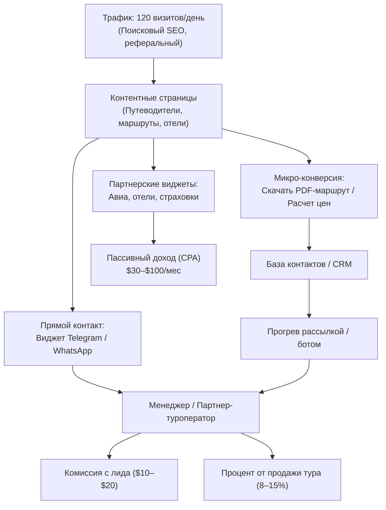

# Исследование рынка и стратегия монетизации: World-Travel.uz

## Цель проекта
Превратить текущий трафик (~120 посетителей в день / ~3 600 в месяц) и контентную базу сайта [world-travel.uz](https://world-travel.uz/) в прогнозируемый источник дохода.

---

## Структура исследования

```
research/world-travel/
├── README.md                  # Навигация, цели и сводный статус
├── 01_AUDIENCE_ANALYSIS.md    # Анализ аудитории: география, интент, поисковый спрос
├── 02_MONETIZATION_MODELS.md  # Модели монетизации, Unit-экономика и расчет дохода
├── 03_COMPETITOR_BENCHMARK.md # Анализ конкурентов (как зарабатывают похожие проекты)
├── 04_LEAD_FUNNEL_AUDIT.md    # Точки захвата контактов, CTA, воронка в Telegram/WhatsApp
└── 05_ACTION_ROADMAP.md       # Пошаговый план внедрения: Quick Wins и долгосрочные шаги
```

---

## Архитектура воронки монетизации



---

## Текущий статус этапов

- [x] **Этап 0:** Определение базового профиля проекта и вводных метрик.
- [ ] **Этап 1:** Анализ аудитории и географии входящего трафика.
- [ ] **Этап 2:** Расчет юнит-экономики по 3 моделям монетизации.
- [ ] **Этап 3:** Аудит конверсионных элементов сайта и подготовка офферов.
- [ ] **Этап 4:** Запуск быстрого тестирования (Quick Wins).
